# KevCast

**Self-hosted narrowcasting / digital signage that is easy to install and easy to use.**
Upload PowerPoint, build a playlist, drag it onto a calendar, and every screen in the building plays it,
even when the network goes down.

[](https://github.com/tahtk3v/kevcast/actions/workflows/build.yml)


KevCast takes its inspiration from Easescreen and is a simpler alternative to Xibo.

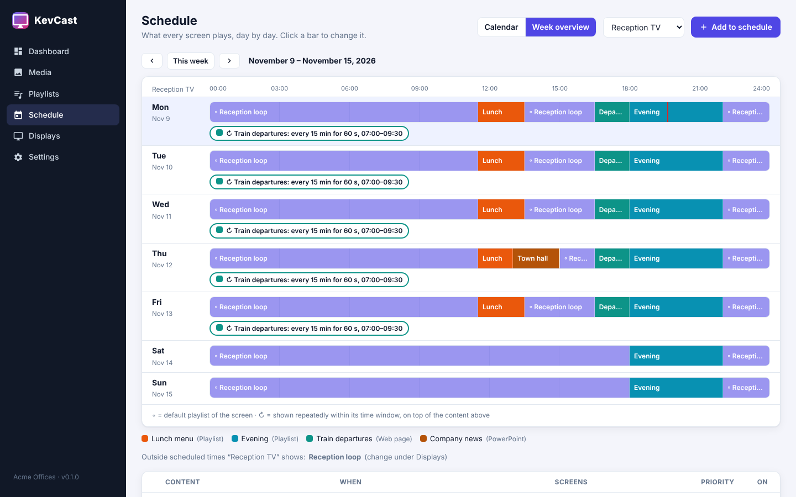

## Highlights

- **PowerPoint as a first-class format.** Drop in a `.pptx` and every slide becomes a screen. No Office licences are needed on the screens.
- **Web pages too.** Show train departures, traffic info, weather or dashboards, with zoom and auto-reload. The Player app even shows sites that normally refuse to be embedded.
- **Visual scheduler.**
  - Click and drag on a week calendar, or see a **week overview** of exactly what each screen plays.
  - Schedule a playlist, a single item or a web page.
  - Repeat weekly, every N weeks, monthly or once, valid for a period.
  - Show something **every 15 minutes for 60 seconds**, and set how long each item stays on screen.
- **Display groups.**
  - Create groups like *Lobby* or *Floor 2* and tick screens to add them. A screen can be in several groups.
  - Anything scheduled for a group plays on all its screens.
  - Copy a group's schedule to another group, and change many schedule entries at once.
  - **Send to screens** puts a playlist on a whole floor in two clicks.
- **KevCast Player app** for Windows, macOS, Linux and Raspberry Pi:
  - finds the server by itself
  - runs as a fullscreen kiosk that only closes with **Alt+Q**
  - **stores the whole schedule locally** and keeps playing when the server is down
  - recovers from crashes and sends screenshots back
  - **restarts every Sunday** so Windows updates get installed
- **KevCast Studio**: a desktop app to manage everything.
  - Browse the folders on your computer (Desktop, Documents, OneDrive…) and upload PowerPoints with a click.
  - The same **Web Studio** is also in any browser.
- **Zero-touch roll-out.** Deploy the MSI or .deb plus a `player.json` with GPO, Intune, MDM or Ansible. Screens appear already approved, named and grouped.
- **Easy to install.** Separate installers for Server, Player and Studio, plus a Windows setup that lets you choose. No Docker, no database server, no licences.

## Screenshots

| | |
|---|---|
| 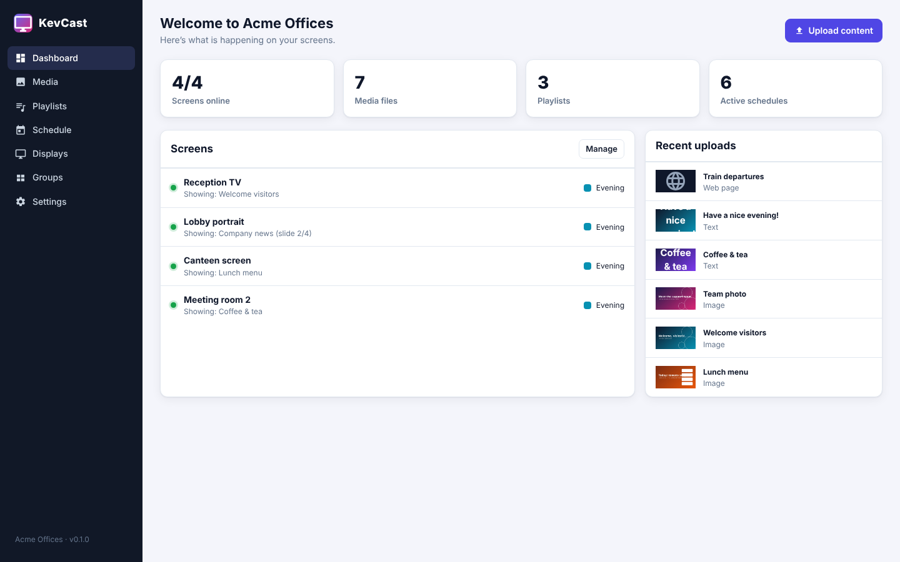 **Dashboard**: every screen and what it shows right now | 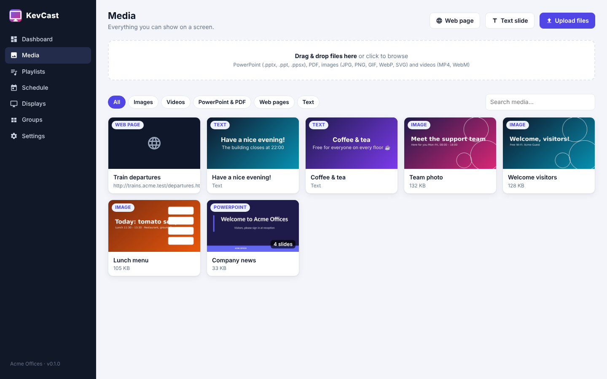 **Media**: PowerPoint, images, video, web pages and text slides |
| 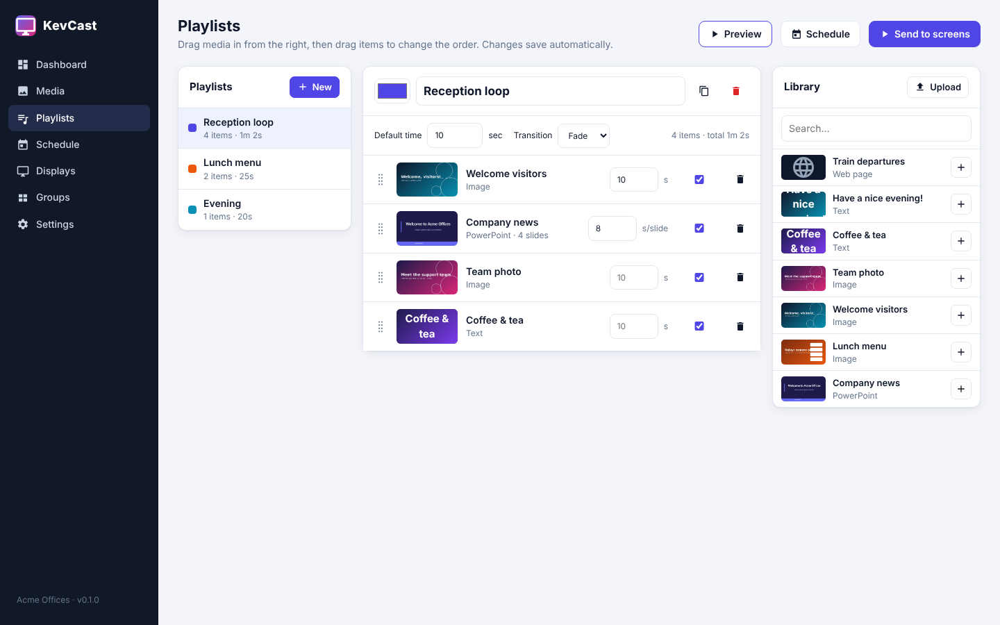 **Playlists**: drag in media, set the time per item | 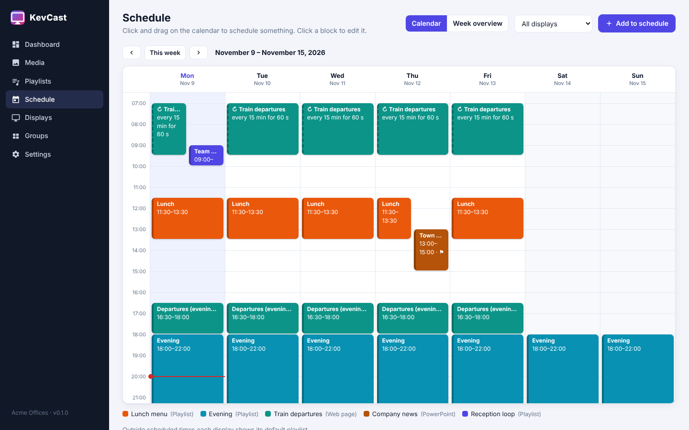 **Schedule**: drag on the calendar; ↻ items repeat |
| 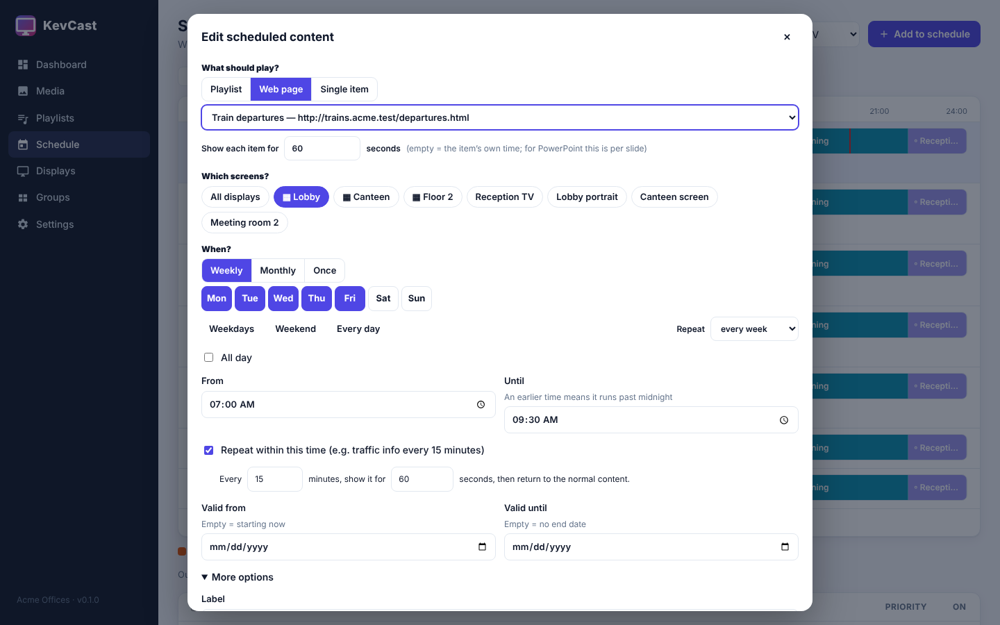 **Schedule a web page** every 15 minutes for 60 seconds | 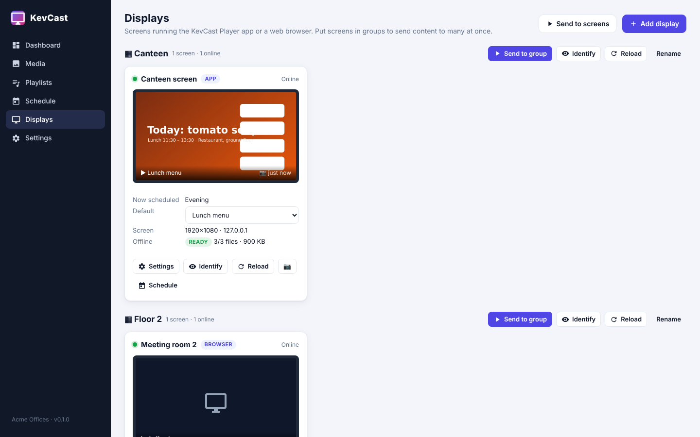 **Displays & groups** with live screenshots and offline status |
| 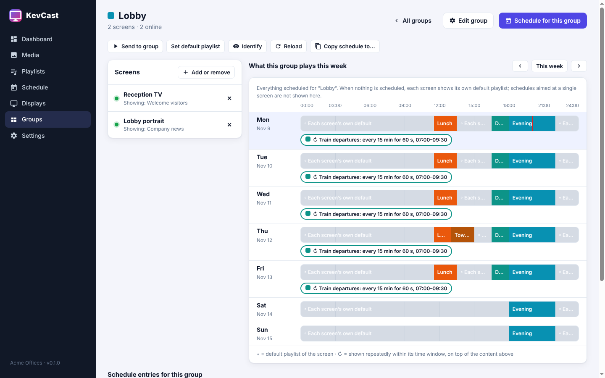 **Groups**: screens, week plan and schedule of a whole group | 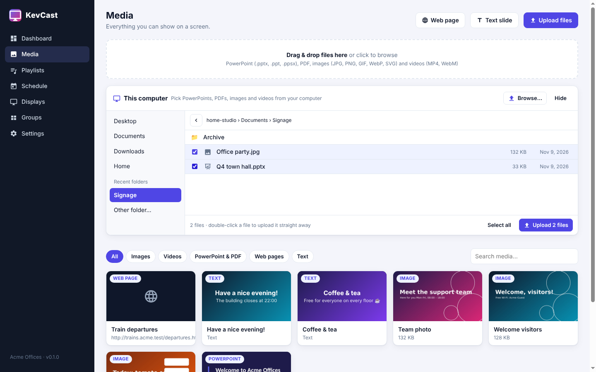 **KevCast Studio**: upload PowerPoints straight from your folders |
| 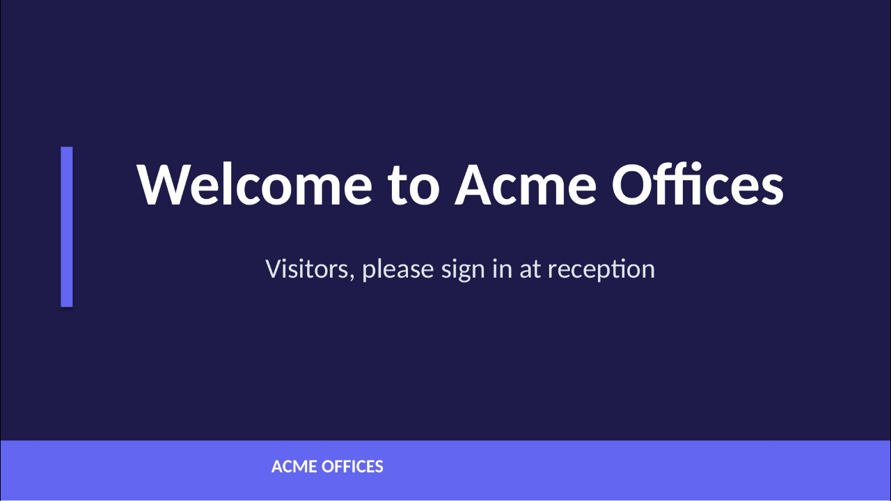 **On screen**: a PowerPoint slide | 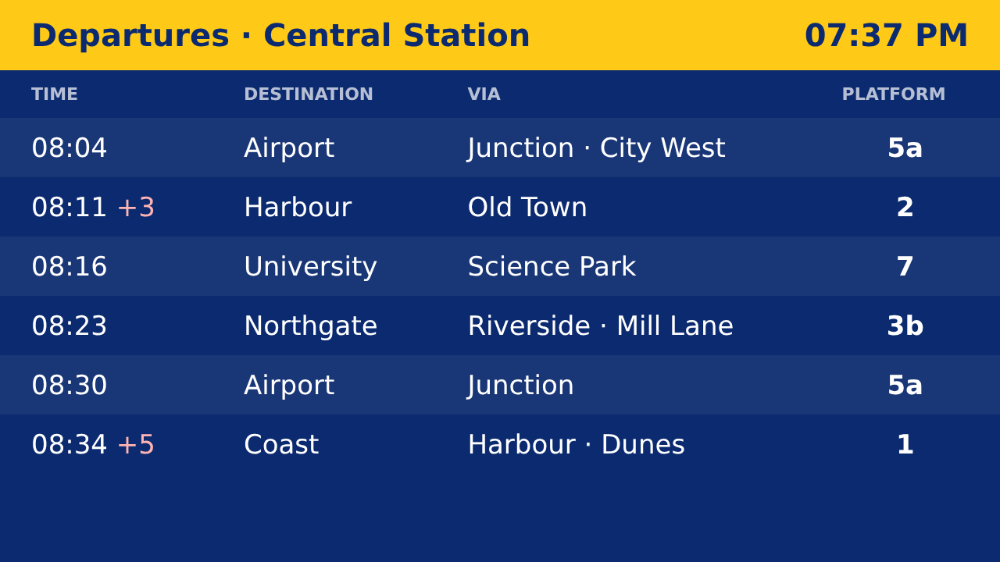 **On screen**: a live departures page |

## Get started

Each part has its own installer. Install only what a computer needs:

| Installer | Install on | Windows | macOS | Linux / Raspberry Pi |
|---|---|---|---|---|
| **KevCast Setup**: pick Server, Player and/or Studio | any Windows PC | `KevCast-Setup-*.exe` | – | – |
| **KevCast Server** | one computer per organisation | `KevCast-Server-Setup-*.exe` | `KevCast-Server-*.pkg` | `kevcast-server_*.deb` |
| **KevCast Player** | each computer behind a screen | `.exe` / `.msi` | `.dmg` | `.deb` / `.AppImage` |
| **KevCast Studio** (optional) | admins' PCs | `.exe` / `.msi` | `.dmg` | `.deb` / `.AppImage` |

Download them from the [latest release](https://github.com/tahtk3v/kevcast/releases/latest). Builds of the latest commit are under the latest [Build workflow run](https://github.com/tahtk3v/kevcast/actions/workflows/build.yml) (**Artifacts**, kept for 7 days).

1. **Install the server.** It adds a **KevCast Web Studio** icon to the desktop.
2. **Open KevCast Web Studio** and create your account.
3. **Add content**: drag a PowerPoint onto **Media**, then add it to a playlist.
4. **Connect a screen**, in one of two ways:
   - install **KevCast Player** (it finds the server automatically), or
   - point any browser at **`http://<server>:8080/player/`**

   The screen shows a code. Enter it under **Displays → Add display**.
5. **Schedule**: drag on the **Schedule** calendar, or use **Send to screens**.

Tip: open `http://<server>:8080/` on any computer for a start page that links to the Web Studio and shows the exact player address.

## Documentation

| | |
|---|---|
| [Installation](docs/installation.md) | Windows, Linux, macOS, HTTPS, backups, upgrades |
| [User guide](docs/user-guide.md) | Media, playlists, schedule, displays, groups, send to screens |
| [KevCast Player](docs/player.md) | Screen app, keyboard shortcuts, Alt+Q exit, offline playback, browser players |
| [KevCast Studio](docs/studio.md) | Desktop management app |
| [Enterprise roll-out](docs/rollout.md) | player.json, provisioning key, GPO, Intune, Ansible, MDM |
| [Configuration](docs/configuration.md) | Environment variables, player.json reference |
| [Architecture](docs/architecture.md) | How it works, data model, offline design, security |
| [API reference](docs/api.md) | REST API for automation |
| [Troubleshooting & FAQ](docs/troubleshooting.md) | Common problems and answers |
| [Development](docs/development.md) | Running from source, tests, building, releasing |

## How it fits together

```
 KevCast Studio / browser ──▶ ┌──────────────────────────┐ ◀── KevCast Player / browser
   (manage)                   │      KevCast Server      │       (one per screen)
                              │  Node.js · port 8080     │
                              │  LibreOffice → slides    │   UDP 41234: auto-discovery
                              └──────────────────────────┘
```

## Contributing

Issues and pull requests are welcome. Please read [CONTRIBUTING.md](CONTRIBUTING.md). Report security issues
privately as described in [SECURITY.md](SECURITY.md). Changes are listed in [CHANGELOG.md](CHANGELOG.md).

## License

[MIT](LICENSE) © Kevin B
