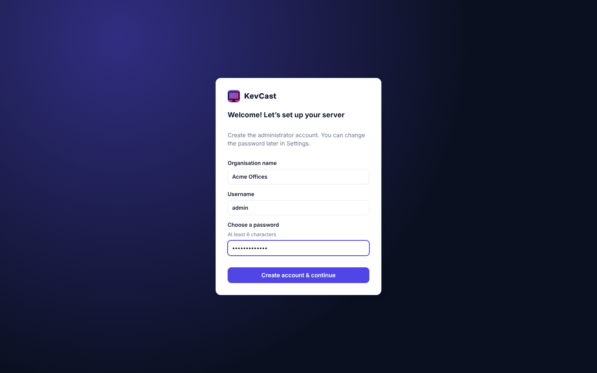
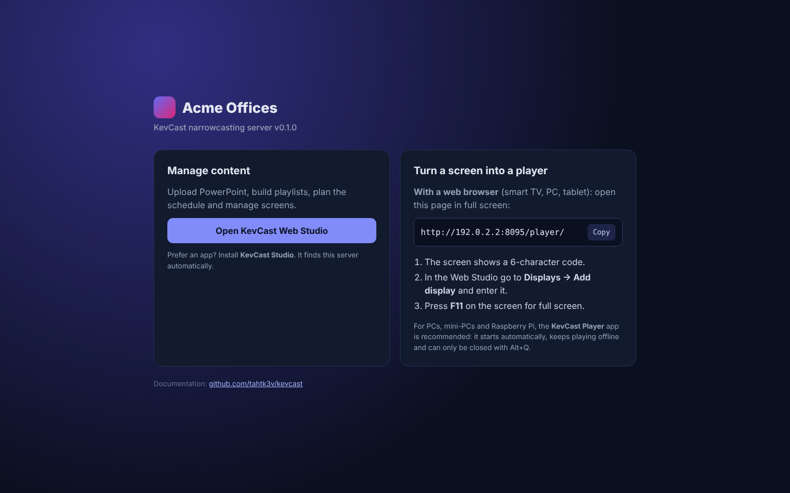

# Installing the KevCast server

The server is a single Node.js program. It stores everything in one data folder: a small JSON database
plus your media files. It needs no database server, web server, Docker or licences.

## Requirements

| | Minimum | Recommended |
|---|---|---|
| OS | Windows 10/11 or Server 2019+, Ubuntu 20.04+, Debian 11+, Raspberry Pi OS (64-bit), Fedora/RHEL 9, macOS 12+ | Any of these on an always-on machine |
| CPU / RAM | 2 cores, 2 GB | 4 cores, 4 GB (PowerPoint conversion uses LibreOffice) |
| Disk | 2 GB + your media | SSD |
| Software | Node.js 20+ (26 LTS recommended; the installers include it), LibreOffice, Poppler (`pdftoppm`) or Ghostscript | Installed by the scripts below |
| Network | TCP **8080** (web/admin/players), UDP **41234** (auto-discovery, optional) | Fixed IP address or DNS name |

Players only talk to the server, never to the internet. An isolated signage network works fine.

## Installers (recommended)

Every component has its own installer, so you only install what a computer needs.
Download them from the [latest release](https://github.com/tahtk3v/kevcast/releases/latest). Builds of the latest commit are under the latest [Build workflow run](https://github.com/tahtk3v/kevcast/actions/workflows/build.yml) (**Artifacts**, kept for 7 days), or build them yourself (see [packaging/README.md](../packaging/README.md)).

| Component | Install it on | Windows | macOS | Linux / Raspberry Pi |
|---|---|---|---|---|
| **Everything, pick what you need** | any Windows PC | `KevCast-Setup-x.y.z-win-x64.exe` | – | – |
| **KevCast Server** | one computer per organisation | `KevCast-Server-Setup-x.y.z-win-x64.exe` | `KevCast-Server-x.y.z-mac-arm64.pkg` / `-x64.pkg` | `kevcast-server_x.y.z_amd64.deb` / `_arm64.deb` |
| **KevCast Player** | every computer behind a screen | `KevCast-Player-…exe` / `.msi` | `KevCast-Player-….dmg` | `KevCast-Player-….deb` / `.AppImage` |
| **KevCast Studio** | admins' PCs (optional, the Web Studio works in any browser) | `KevCast-Studio-…exe` / `.msi` | `KevCast-Studio-….dmg` | `KevCast-Studio-….deb` / `.AppImage` |

The server installers include their own Node.js runtime, so nothing has to be installed beforehand.

### Windows: KevCast Setup

`KevCast-Setup` asks which parts to install:

| Option | What it does |
|---|---|
| **Server** | Installs to `C:\Program Files\KevCast\Server`, with data in `C:\ProgramData\KevCast`. Registers a background service (Task Scheduler, runs as SYSTEM at boot, restarts on failure) and opens the firewall (TCP 8080, UDP 41234). Puts a **KevCast Web Studio** icon on the desktop. |
| ↳ **LibreOffice** | Ticked if it isn't installed yet. Installs LibreOffice with winget (needs internet), for PowerPoint conversion. Poppler is already included. |
| **KevCast Player** | For a computer connected to a screen. Starts at sign-in for every user and adds a desktop shortcut. |
| **KevCast Studio** | Desktop management app with a desktop shortcut |

`KevCast-Server-Setup` is the same installer with only the server.

When it finishes, the installer:
- shows the address that browser-based screens must open (`http://<computer-name>:8080/player/`)
- can open the Web Studio right away

The Start menu folder **KevCast** contains:
- **KevCast Web Studio**
- **Connect a screen**: the server's start page, showing the exact player address
- the server log and the data folder
- the uninstaller

To change the port, edit `C:\Program Files\KevCast\Server\kevcast-server.cmd` (`set PORT=…`). Then restart the **KevCast Server** task in Task Scheduler, or reboot. Re-running the installer keeps the port you set.

For a silent install (Intune, SCCM, a script), run `KevCast-Server-Setup-x.y.z-win-x64.exe /S`. Add `/NOLIBREOFFICE` to skip LibreOffice.
The exit code is 0 when it worked.

Upgrade by running a newer installer over the old one. Uninstall via *Settings → Apps → KevCast*. Your content in `C:\ProgramData\KevCast` is always kept.

### Linux: kevcast-server .deb

```bash
sudo apt install ./kevcast-server_0.4.0_amd64.deb     # arm64 for Raspberry Pi 4/5
```
`apt` pulls in LibreOffice, Poppler and matching fonts automatically. The package:
- installs to `/opt/kevcast-server` and creates the `kevcast` system user
- stores data in `/var/lib/kevcast`
- starts the `kevcast` systemd service
- adds **KevCast Web Studio** to the application menu and to your desktop
- reads its settings from `/etc/default/kevcast` (`PORT=8080`). Restart with `sudo systemctl restart kevcast` after changing them.

Uninstall with `sudo apt remove kevcast-server`. The data folder is kept.

### macOS: KevCast-Server .pkg
The package is not yet signed with an Apple Developer certificate. If macOS refuses to open it, open
**System Settings → Privacy & Security**, click **Open Anyway** next to the message about the package, and run it again.

Double-click the `.pkg`. The package:
- installs to `/Library/KevCast Server` and runs as a LaunchDaemon (starts at boot)
- stores data in `/Library/Application Support/KevCast`
- puts **KevCast Web Studio** on the desktop and in Applications
- opens the start page when it's done

For PowerPoint conversion, also install LibreOffice and Poppler: `brew install --cask libreoffice && brew install poppler`. Or download LibreOffice from libreoffice.org; the Web Studio dashboard warns while anything is missing.

## Install scripts (alternative)

Prefer a script, or installing from a git checkout? Use the scripts below. They install the same server, using the system's Node.js.

### Windows script

1. Download the repository (**Code → Download ZIP** on GitHub) and extract it, or `git clone` it.
2. Double-click **`install\windows\install.bat`** and accept the administrator (UAC) prompt.

The script ([`install.ps1`](../install/windows/install.ps1)):

| Step | Details |
|---|---|
| Installs prerequisites with `winget` | Node.js LTS, LibreOffice and Poppler, skipping any that are already present |
| Copies the program | `C:\Program Files\KevCast` |
| Creates the data folder | `C:\ProgramData\KevCast` (database, media, screenshots, `kevcast.log`) |
| Registers a startup task | Task Scheduler → **KevCast Server**. It runs as SYSTEM at boot and restarts on failure. |
| Opens the firewall | Inbound TCP 8080 and UDP 41234 on Domain and Private profiles |
| Opens the admin | `http://localhost:8080/admin/` in your browser |

Options: `install.ps1 -Port 9000 -InstallDir D:\KevCast -DataDir D:\KevCastData`.

If `winget` is unavailable (older Windows Server), install these yourself first, then run the script again:
- Node.js LTS from nodejs.org
- LibreOffice from libreoffice.org
- Poppler for Windows (github.com/oschwartz10612/poppler-windows). Unzip it to `C:\Program Files\poppler`, so that `pdftoppm.exe` ends up in `C:\Program Files\poppler\Library\bin`. Alternatively, set `PDFTOPPM_PATH`.

**Manage the service**
```powershell
Start-ScheduledTask -TaskName "KevCast Server"
Stop-ScheduledTask  -TaskName "KevCast Server"
Get-Content C:\ProgramData\KevCast\kevcast.log -Tail 50 -Wait
```

**Uninstall**: run `install\windows\uninstall.ps1` as administrator. Your content in `C:\ProgramData\KevCast` is kept.

### Linux script (Ubuntu, Debian, Raspberry Pi OS, Fedora, RHEL)

```bash
git clone https://github.com/tahtk3v/kevcast.git
cd kevcast
sudo ./install/linux/install.sh
```

The script ([`install.sh`](../install/linux/install.sh)):
- installs Node.js (the current LTS from NodeSource if the distribution's version is too old), `libreoffice-impress`, `poppler-utils` and fonts that match the Office fonts (Carlito = Calibri, Caladea = Cambria, Liberation = Arial/Times)
- copies the program to `/opt/kevcast` and creates a `kevcast` system user
- stores data in `/var/lib/kevcast`
- creates and starts the systemd service `kevcast`
- opens TCP 8080 and UDP 41234 in `ufw` or `firewalld` if one is active

Use another port with `sudo PORT=9000 ./install/linux/install.sh`.

```bash
sudo systemctl status kevcast
sudo systemctl restart kevcast
journalctl -u kevcast -f
```

**Uninstall**: `sudo ./install/linux/uninstall.sh`. The data folder `/var/lib/kevcast` is kept.

> **Fonts matter.** PowerPoint files are rendered with the fonts installed on the server. If a
> presentation uses a corporate font, install it on the server **for all users** (Windows: right-click →
> *Install for all users*; Linux: copy it to `/usr/local/share/fonts` and run `fc-cache -f`), then click
> **Re-convert**. KevCast warns on the media card when a presentation uses a font the server doesn't have.

### macOS script

```bash
./install/macos/install.sh
```
This installs Homebrew if needed, then Node.js, Poppler and LibreOffice. It copies KevCast to `~/Applications/KevCast`,
stores data in `~/Library/Application Support/KevCast` and registers a LaunchAgent (`com.kevcast.server`).
The LaunchAgent starts the server when that user logs in. For a dedicated Mac, turn on automatic login.

## Manual installation (any OS)

```bash
npm ci --omit=dev
PORT=8080 KEVCAST_DATA=/path/to/data node server/index.js
```
At startup the server prints the admin address, the player addresses and whether LibreOffice and a PDF renderer were found.
See [Configuration](configuration.md) for all environment variables.

## First run




Open **KevCast Web Studio**, the desktop icon or `http://<server-address>:8080/admin/`. The first visit asks you to create the first administrator account and
name your organisation. That name is shown on idle screens and in the apps' server list.

Opening the server address without a path, `http://<server-address>:8080/`, shows a start page.



The start page has a button to the Web Studio and the exact address that browser-based screens must open.

Next, check **Settings → Server**: both *LibreOffice* and *Slide renderer* should show **OK**.

## HTTPS and a friendly address (optional)

KevCast speaks plain HTTP, which is fine on an internal network. For HTTPS or an address like
`https://signage.company.com`, put a reverse proxy in front of it. The proxy must not buffer the live
event streams (`/api/events`, `/api/player/events`).

**Caddy** (gets certificates automatically):
```
signage.company.com {
    reverse_proxy 127.0.0.1:8080 {
        flush_interval -1
    }
}
```

**nginx**:
```nginx
server {
    listen 443 ssl;
    server_name signage.company.com;
    client_max_body_size 4g;              # large video uploads
    location / {
        proxy_pass http://127.0.0.1:8080;
        proxy_set_header Host $host;
        proxy_set_header X-Forwarded-For $proxy_add_x_forwarded_for;
        proxy_buffering off;              # live updates (Server-Sent Events)
        proxy_read_timeout 1h;
    }
}
```

**IIS**: use the *URL Rewrite* and *Application Request Routing* modules. Set the reverse proxy to the
`localhost:8080` address and set *Response buffer threshold* to 0.

Auto-discovery (UDP) only works on the local network. Players outside it need the address entered once,
or deployed through [player.json](rollout.md).

## Backup and restore

Everything is in the data folder:

```
data/
  db.json          database: settings, media list, playlists, schedules, displays
  secret.key       signs admin login cookies (keep it private)
  media/<id>/      uploaded files and converted slides
  screenshots/     latest screenshot per display (can be deleted)
```

- **Backup**: copy the whole data folder, ideally while the server is stopped (or right after a change). **Settings → Download backup** exports the database without passwords or media.
- **Restore**: stop the server, put the folder back, start the server.
- **Move to a new server**: install KevCast on the new machine, stop it, copy the data folder over, start it. If the new server has a different address, update players with **Ctrl+Shift+K** on each screen, or deploy a new `player.json`.

## Upgrading

1. Get the new version.
2. Run the newer installer, `apt install` the newer `.deb`, or run the same install script again. The program files are replaced and the data folder is left alone.
3. Players notice the new player code within a minute, or at the nightly refresh. Use **Reload** on a group to update them straight away.

## Ports

| Port | Protocol | Used for |
|---|---|---|
| 8080 (`PORT`) | TCP | Admin, API, player, media downloads, live updates |
| 41234 (`DISCOVERY_PORT`) | UDP | Player and Studio find the server automatically. Optional: if blocked, enter the address by hand. |
