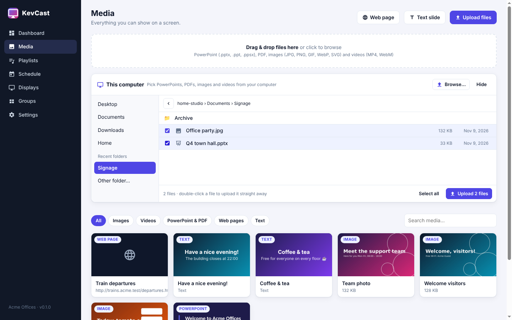

# KevCast Studio

KevCast Studio is the desktop app for managing KevCast. It runs on Windows, macOS and Linux. It shows the same
interface as the web admin (`/admin/`), in a native window with menus and keyboard shortcuts.
Use whichever you prefer; both always show the same data.

## Installing

| Platform | File |
|---|---|
| Windows | `KevCast-Studio-x.y.z-win-x64.exe` (choose the folder) or `.msi` (managed roll-out) |
| macOS | `KevCast-Studio-x.y.z-mac-*.dmg` |
| Linux | `.deb` or `.AppImage` |

## Connecting

At first start Studio searches the network and lists every KevCast server it finds, with the
organisation name. If there is only one, it connects straight away. You can also type an address.

Then sign in with your admin account. Studio remembers the server, the window size and position,
and up to five recent servers (**File → Recent servers**).

IT can preset the server with `studio.json` (same folders as [`player.json`](rollout.md)) or
`--server=http://…`.

## Menus and shortcuts

| Menu | Item | Shortcut |
|---|---|---|
| File | Upload files… (opens the file dialog) | Ctrl/Cmd+U |
| File | New playlist | Ctrl/Cmd+N |
| File | Connect to another server… / Recent servers / Open in web browser | |
| Go | Dashboard · Media · Playlists · Schedule · Displays · Groups | Ctrl/Cmd+1 … 6 |
| Go | Settings | Ctrl/Cmd+, |
| View | Reload, zoom, full screen, developer tools | |

## Uploading from this computer

Studio can reach the files on your computer, which the browser version can't.
On the **Media** page you'll find a **This computer** panel:

| Part | What it does |
|---|---|
| **Quick folders** (left) | Desktop, Documents, Downloads, Pictures, Videos, OneDrive (personal and business), your home folder and USB/network drives, plus **recent folders** you uploaded from |
| **Other folder…** | Open any folder with the system's folder dialog |
| **File list** | Only what KevCast can show: PowerPoint (`.pptx .ppt .ppsx .odp…`), PDF, images and videos, newest first. Folders open with a click; the **‹** button goes up a folder. |
| **Uploaded** badge | This file (same name and size) is already in the library |
| **Upload N files** | Uploads the ticked files, with a progress bar per file. **Double-click** a file to upload just that one straight away. |
| **Browse…** | The normal Windows/macOS file dialog, filtered to supported files, with multi-select |

Studio remembers the last folder you used and opens there next time.

Other ways to upload in Studio:
- **File → Upload files…** (Ctrl/Cmd+U) from anywhere
- **Drag files** from Explorer or Finder onto the window
- **Upload** in a playlist's library panel: the files are uploaded **and added to that playlist** in one step (this works in the browser too)

Files are streamed straight from disk to the server, so large videos upload fine. Uploading only reads the files you choose;
Studio never changes or deletes anything on your computer.

## Working in Studio

- **Drag PowerPoint files** from Explorer or Finder straight onto the window to upload them.
- **Preview** in the playlist editor opens a separate preview window.
- **Download backup** opens a normal save dialog.
- Links to other websites open in your default browser.

See the [user guide](user-guide.md) for the screens themselves: media, playlists, schedule, displays, groups
and *Send to screens*.
