# User guide

The admin is available at `http://<server>:8080/admin/` and inside [KevCast Studio](studio.md).
Changes reach the screens within seconds. Nothing needs a "publish" button.

- [Dashboard](#dashboard)
- [Media](#media)
- [Playlists](#playlists)
- [Schedule](#schedule)
- [Displays](#displays)
- [Groups](#groups)
- [Send to screens](#send-to-screens)
- [Settings](#settings)
- [Tips for good-looking screens](#tips-for-good-looking-screens)

---

## Dashboard

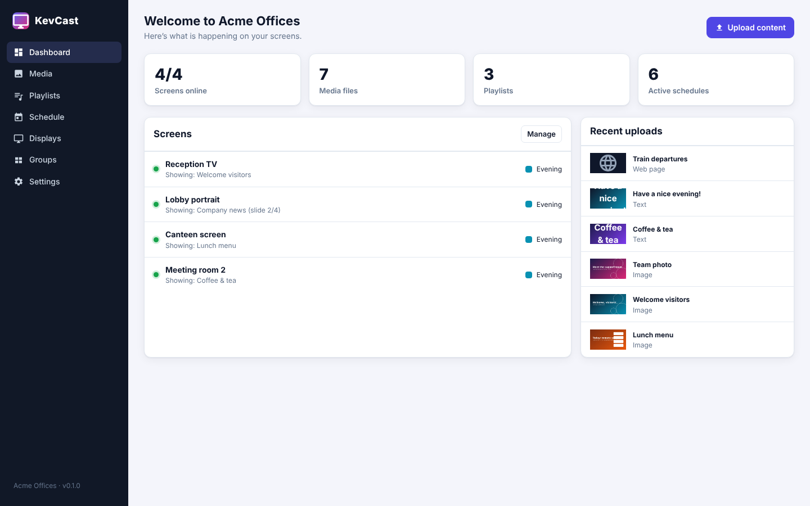

- **Counters**: screens online, media, playlists and active schedules. Click one to go there.
- **Get started in 4 steps**: a checklist that disappears once you have content, a playlist, a screen and a schedule.
- **Screens**: every display with its live status and what it is showing right now (including the slide number).
- **Recent uploads**.
- A warning appears at the top if the server can't convert PowerPoint (LibreOffice or Poppler missing).

## Media

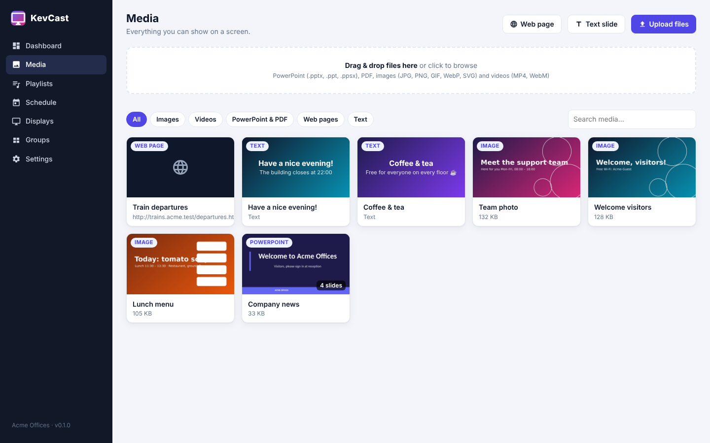

Everything you can show on a screen lives here.

### Uploading
Drag files **anywhere** onto the admin window, or click **Upload files**. A progress bar shows for each file.

| Type | Formats | Notes |
|---|---|---|
| PowerPoint & PDF | `.pptx .ppt .pps .ppsx .pot .potx .odp .key .pdf` | Converted to one image per slide (1920 px wide). Shows a spinner while converting. |
| Images | `.jpg .png .gif .webp .svg .bmp` | Shown as-is. |
| Videos | `.mp4 .webm .mov .m4v .ogv .mkv` | H.264 MP4 plays everywhere. Muted by default so screens can autoplay. |

Upload limit: 4 GB per file.

### Web pages
Some information only exists as a web page: train departures, traffic info, weather, a Power BI or Grafana dashboard.
Click **Web page**, enter the address (e.g. `https://example.org/departures`) and give it a name.

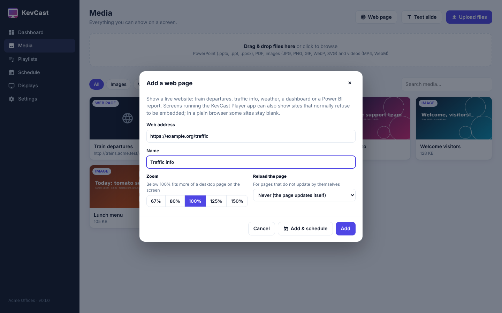

| Setting | What it does |
|---|---|
| **Zoom** | Scales the page. Below 100% fits more of a desktop page on a TV, and above 100% makes small text readable from a distance. |
| **Reload the page** | Reloads it every minute, 5 minutes, 15 minutes or hour. Use this for pages that don't refresh themselves. |
| **Add & schedule** | Saves the page and opens the schedule dialog straight away |

**Preview on a screen** (when editing a page) shows it exactly as a screen will.

You can put a web page in a playlist like any other item, or [schedule it directly](#scheduling-a-web-page).

> **Sites that refuse to be embedded.** Many sites forbid being shown inside another page. The **KevCast Player app**
> ignores that restriction, because a signage screen is a display, not a browser, so departure boards and
> traffic maps work there. In a plain browser player such sites stay blank. See [Troubleshooting](troubleshooting.md#a-web-page-stays-blank).

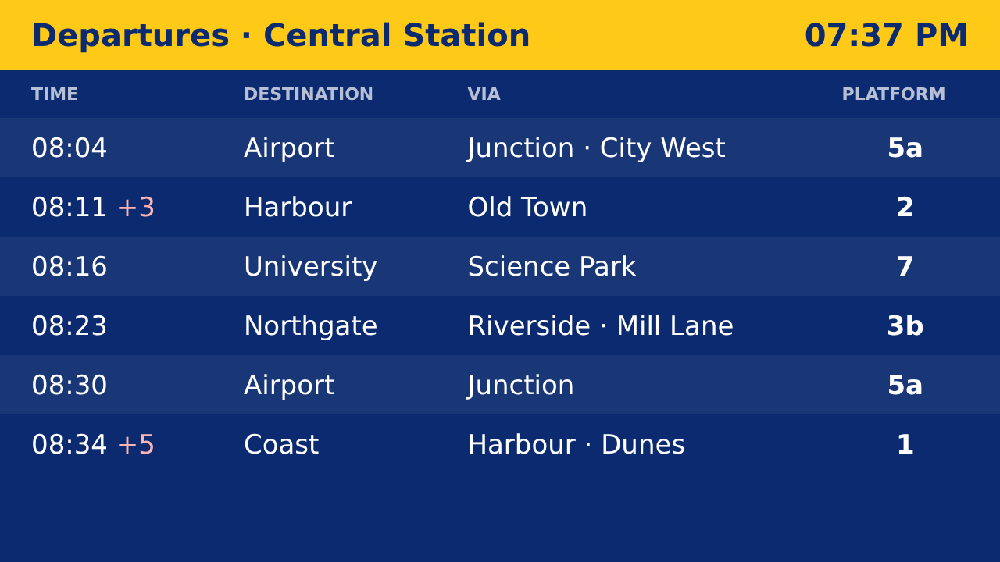

### Text slides
Click **Text slide** to make an announcement without PowerPoint. You set:
- a heading and body text, with a live preview
- one of six colour presets, or your own background gradient and text colour
- alignment (centre or left) and size (S, M or L)

### Weather and traffic slides
Click **Weather** or **Traffic** on the Media page, search for the place (town, address or postcode) and click **Add**.
KevCast keeps the slides up to date by itself; the screens show them like any other item in a playlist or schedule.

**Weather** shows the weather now, today hour by hour, the next 5 days and the official weather warnings for that
place: KNMI's *code geel/oranje/rood* in the Netherlands (and KNMI's fog notices), and the national weather service's
warnings elsewhere in Europe. Untick what you don't want to show. Forecast: MET Norway; warnings: MeteoAlarm.

**Traffic** shows travel times by car from the place to the nearest big cities, or to destinations you choose (up to
8: tap the cities, or search any other place). In the Netherlands the times include current traffic jams and show
accidents on the way (live data from NDW). Elsewhere they are normal travel times. Routes: OpenStreetMap/OSRM.

- The slides follow each screen's **Language** and the server's **Clock** setting (24-hour or 12-hour, under
  **Settings → General**). To show one slide in another
  language, pick it under **Language** in the slide's settings.
- Click the slide on the Media page to see when its data was last updated, or why it couldn't be updated.
- The KevCast server needs internet access for these slides; the screens don't. If the internet is gone for a while,
  the slides keep the last data they had. See [Configuration](configuration.md#internet-access-for-weather-and-traffic-slides)
  for the addresses to allow in a firewall.
- For a traffic site or map from elsewhere (ANWB, a traffic camera, …), add it as a **Web page** instead.

### Managing media
Click a card to open its details. From there you can:

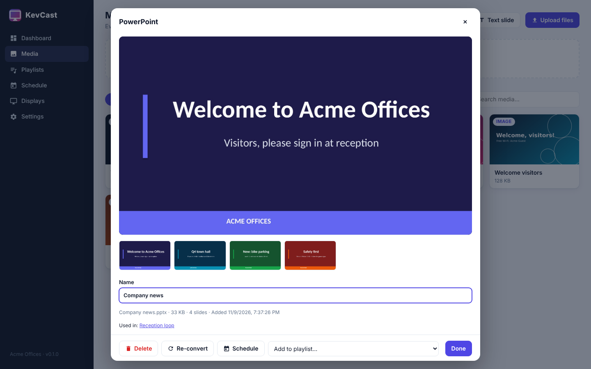

- **Rename** it.
- **Browse slides**: click a thumbnail in the strip to preview that slide.
- **Add to playlist**, or create a new playlist from the item.
- **Re-convert** a presentation, for example after installing a font on the server.
- **Edit text** (text slides) or **Edit web page** (web pages).
- **Schedule** the item on its own, without a playlist.
- **Delete** it. The item is also removed from every playlist.

**Deleting quickly:** hover over a card and click the red 🗑 in its corner. To delete several items at once, tick the
box next to it on each card (once one is ticked, clicking a card ticks it), then click **Delete** in the bar that appears.

**Fonts** (PowerPoint files): the details list every font the presentation uses, whether the server has it, and
whether PowerPoint embedded it in the file. If text comes out garbled or in the wrong place, choose
**Arial for all text**, or click **Replace with Arial** next to the font that goes wrong (administrators; it then applies
to every presentation, see **Settings → Server → Font replacements**). Your file itself is never changed.

**⚠ fonts missing on the server** on a PowerPoint card means the slides were made with a replacement font. The Media page
says which fonts; install them on the server *for all users* and click **Re-convert these**. See
[Troubleshooting](troubleshooting.md#slides-look-different-from-powerpoint-or-the-text-is-garbled-or-misplaced).

**Used in** lists the playlists that contain the item. Use the filter chips (Images, Videos, PowerPoint & PDF, …) and the search box to find things.

## Playlists

A playlist is an ordered set of media that loops.

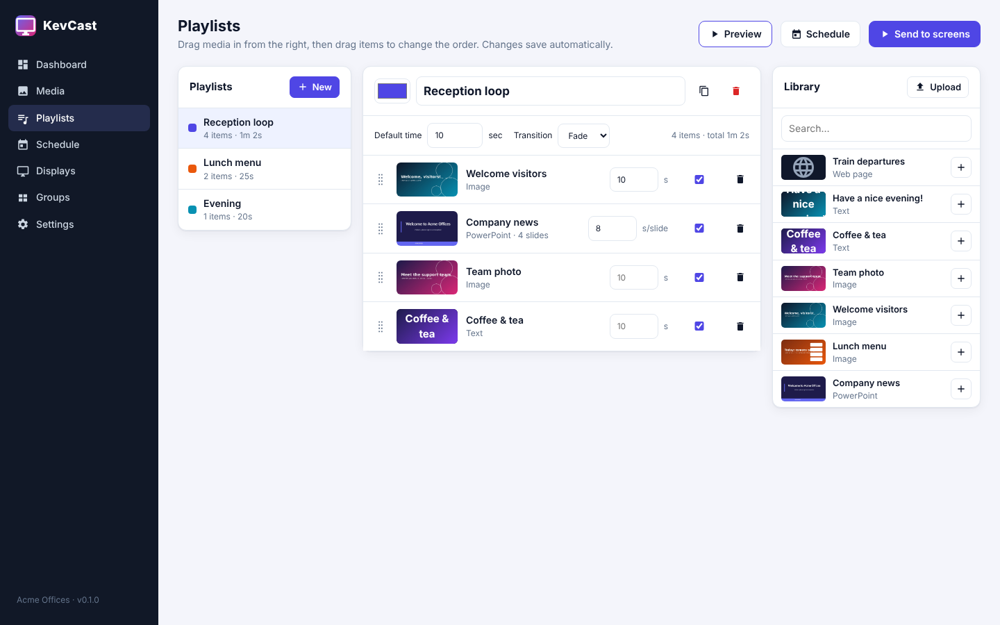

The page has three columns: your playlists, the editor and the media library.

| Action | How |
|---|---|
| Create | **New** |
| Add media | Drag from the library into the list (at any position), or click **+** to add at the end |
| Reorder | Drag an item by its handle ⋮⋮ |
| Duration | Seconds per item. For PowerPoint it's **seconds per slide**. Empty = playlist default. For videos, empty = play to the end. |
| Skip temporarily | Untick the checkbox; the item stays in the list |
| Remove | Hover over the row and click 🗑. The file stays in Media. **Undo** in the message puts it back. |
| Delete media from the library | Hover over it in the library on the right and click 🗑 |
| Rename / colour | Edit the name at the top. The colour is used in the schedule calendar. |
| Default time and transition | Fade, Slide, Zoom or None for the whole playlist |
| Preview | Opens exactly what a screen will show, in a new window |
| Duplicate / delete | Icons next to the name, or hover over a playlist in the left column and click 🗑 |

Changes save automatically. *All changes saved* appears at the top. The total running time is shown above the list.

### A playlist for each group

Give a playlist **the same name as a display group** (capitals and spaces at the ends don't matter), and every screen in
that group plays it whenever nothing is scheduled. You don't have to schedule it or set it as each screen's default.

- The editor then shows *Plays on group “Canteen”* and the playlist list marks it with ▦ group.
- A group's page shows **Group playlist: …**, or **Create playlist “…”** if there isn't one yet.
- Scheduling or sending that playlist preselects its group.
- Schedules still take priority. A group playlist replaces the screens' own default playlist; rename the playlist and
  the screens go back to their own default.
- A screen in several groups with their own playlist plays the playlist of the group listed first in its settings.

## Schedule

The schedule decides **what plays when, and where**. There are two views:
- **Calendar**: plan and edit.
- **Week overview**: see exactly what a screen shows, day by day.

### Calendar

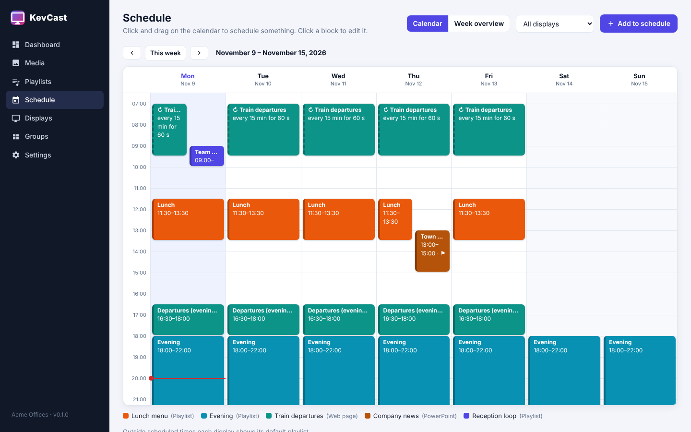

- A week view (Monday to Sunday), with **This week** and arrows to page through weeks. Today is highlighted and a red line shows the current time.
- **Click and drag** on a day to make a new entry for that time range (snaps to 30 minutes). Click a block to edit it.
- Blocks that overlap are drawn side by side. Recurring items (↻) are striped, and disabled entries are faded.
- The **display filter** (top right) shows only the entries that apply to one screen.
- Below the calendar, a table lists every entry with *what*, *when*, *screens*, *priority* and an on/off switch.

### Week overview

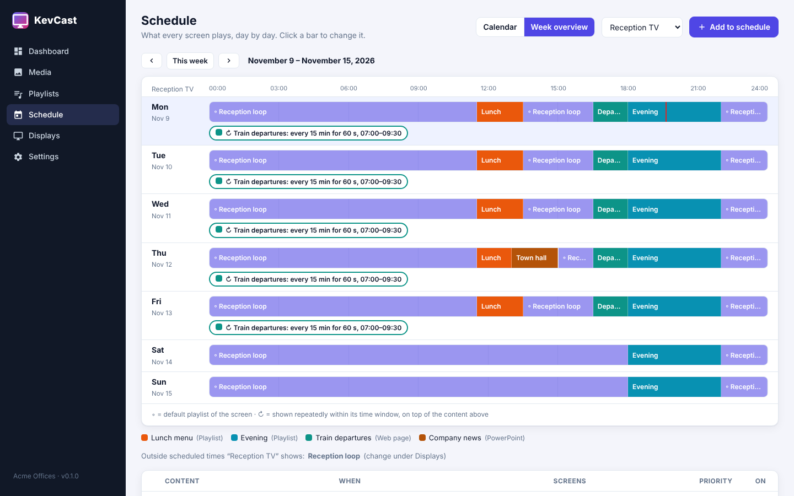

Pick a screen at the top right. Each day of the week is one bar from 00:00 to 24:00, showing what that screen will **actually** play:
- coloured bars for scheduled content
- light, striped bars (◦) for the screen's default playlist
- **↻ chips** under the bar for items that repeat within a time window, e.g. *Train departures every 15 min for 60 s, 07:00–09:30*

Click a bar or chip to edit it, or click an empty part of a day to schedule something new on that day.

### Adding something to the schedule

Click **Add to schedule**, drag on the calendar, or use **Schedule** on a playlist, media item or web page.

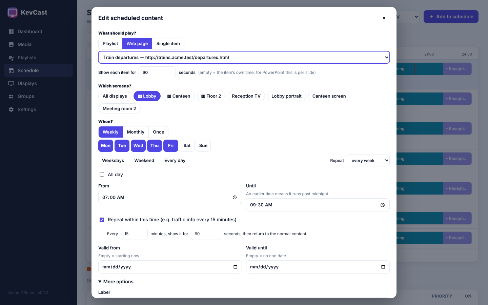

| Field | Meaning |
|---|---|
| **What should play?** | A **Playlist**, a **Web page** (pick one, or **+ New web page…** to add one right here), or a **Single item** such as one PowerPoint, image or video |
| **Show each item for** | Seconds each item stays on screen before the next one. Empty = the item's own time. For PowerPoint it is per slide. |
| **Which screens?** | **All displays**, one or more groups (▦), and/or individual displays |
| **When?** | **Weekly** (pick days, then *every week*, *every 2/3/4 weeks*), **Monthly** (on day 1–31; the 31st means the last day in shorter months) or **Once** (a single date) |
| **All day / From–Until** | The time window. If *Until* is earlier than *From*, it runs past midnight (e.g. 22:00–06:00). |
| **Repeat within this time** | Show it **every N minutes for N seconds**, then go back to the normal content. For example: traffic info every 15 minutes for 60 seconds between 07:00 and 09:30. |
| **Valid from / Valid until** | The period in which the entry counts, e.g. a campaign from 1 to 14 December. Leave empty for "from now" and "forever". |
| **Label** (more options) | Name shown on the calendar |
| **Priority** (more options) | **Normal**, **High** or **Urgent**, used when entries overlap |
| **Enabled** | Switch an entry off without deleting it |

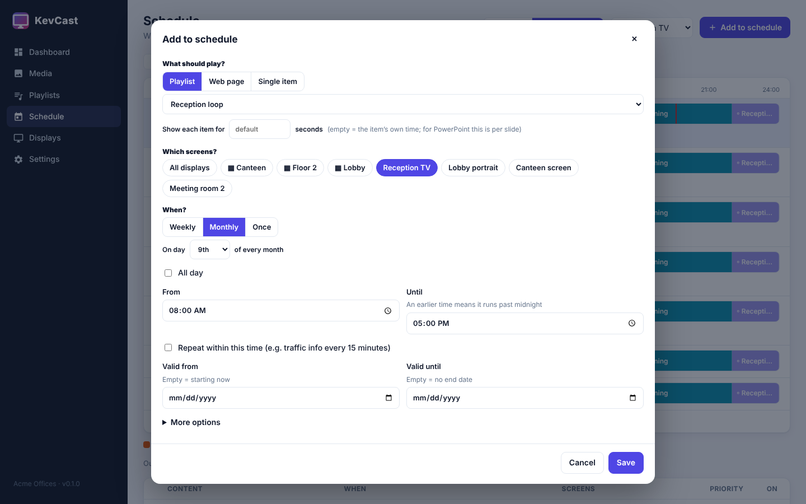

### Scheduling a web page
1. **Add to schedule** → **What should play?** → **Web page**.
2. Pick an existing page, or choose **+ New web page…** and type the address (zoom and reload can be set right there).
3. Set **Show each item for**: how long the page stays up before the next scheduled content. With a single web page, this only matters together with *Repeat within this time*.
4. Choose the screens and the time, for example weekdays 07:00–09:30 with *Repeat within this time: every 15 minutes, 60 seconds*.

### Changing many entries at once

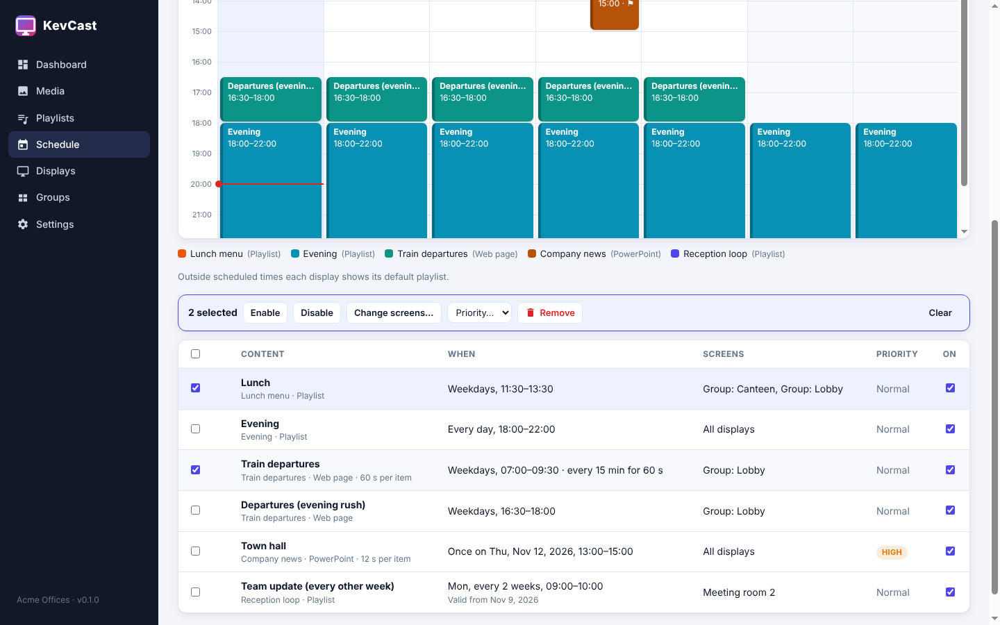

Tick entries in the table under the calendar, or on a group's page; the header checkbox selects all. Then:
- **Enable** / **Disable**
- **Change screens…**: set the screens and groups of all selected entries in one go
- **Priority…**
- **Remove**

The calendar's screen filter (top right) can also show a whole **group** (▦), in both the calendar and the week overview.

### Which entry wins?
When more than one entry is active for a screen at the same moment:
1. The **highest priority** wins (Urgent > High > Normal).
2. On equal priority, a **recurring item** (↻) wins during its few seconds. That's how it interrupts the normal content.
3. Then the **most specific** entry wins: aimed at this display > aimed at its group > aimed at everyone.
4. Otherwise the **most recently created** entry wins.

If no entry is active, the screen plays its **default playlist**. If it has none, it shows a clock with your organisation name.
After an interruption, a playlist continues where it left off.

Screens carry a copy of the schedule, so switches happen on time even when the server is unreachable.

## Displays

### Adding a display

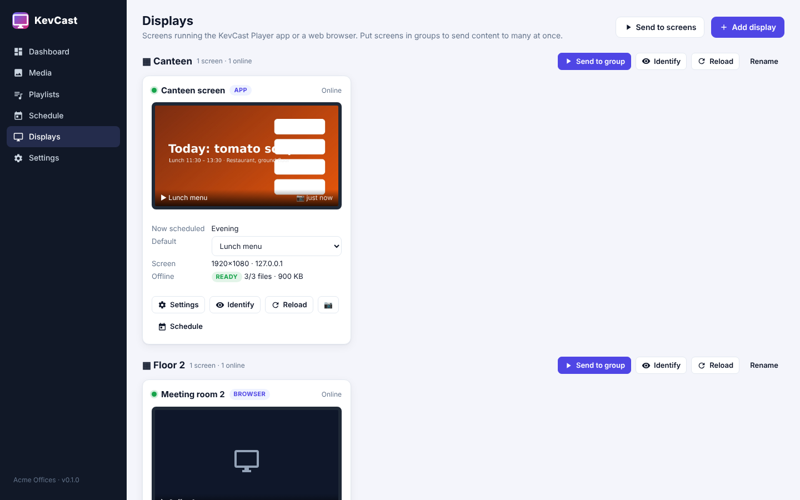

1. Start **KevCast Player** on the screen, or open `http://<server>:8080/player/` in its browser. The **Connect another screen** card at the bottom of the Displays page shows the exact address, with a copy button.
2. The screen shows a 6-character code. The **Displays** menu gets a "1 new" badge.
3. Click **Add display** and fill in:
   - the code
   - a name (e.g. *Reception TV*)
   - optionally one or more groups (e.g. *Lobby*); click a group to select it, or type a new name and click **Add**
   - a default playlist
4. Click **Connect display**.

For many screens at once, skip pairing with a [provisioning key](rollout.md).

### Selecting many screens

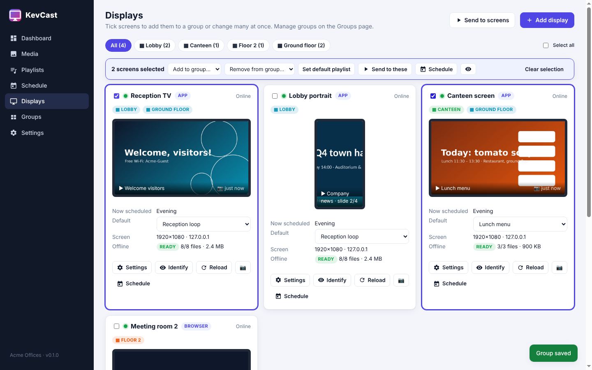

Tick the box on display cards, or use **Select all**, to change several screens at once. The bar that appears lets you:
- **Add to group…**, including **+ New group…**
- **Remove from group…**
- **Set default playlist**
- **Send to these** / **Schedule** for exactly the selected screens
- **Identify**

The chips above the cards filter by group (**All**, each group, **No group**).

### The display card
- A checkbox to select it, the name, and its **group badges**. Click a badge to open that group.
- Online status, plus an **App** or **Browser** badge.
- A live preview: the latest **screenshot** for app players, otherwise the current slide.
- What is scheduled now, the default playlist (change it right there), resolution and IP address.
- **Offline: Ready 12/12 files** (app players): how much of the schedule is stored on the device.
- Buttons:
  - **Settings**
  - **Identify**: shows the name full-screen for 10 seconds
  - **Reload**
  - **📷**: take a screenshot now
  - **Schedule**: opens the calendar filtered to this screen

### Display settings

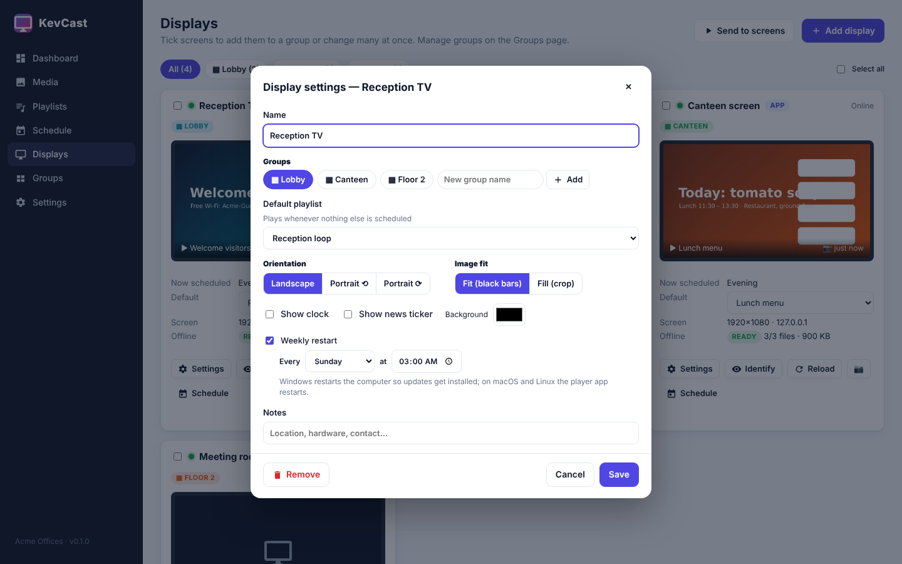

| Setting | Options |
|---|---|
| Name, notes | Free text |
| Groups | Click groups to add or remove this screen; type a new name and click **Add** to create a group |
| Default playlist | Plays when nothing is scheduled |
| Orientation | Landscape, Portrait ⟲ or Portrait ⟳. Use portrait for a TV mounted on its side; the content is rotated for you. |
| Image fit | **Fit** shows everything (black bars if the shape differs). **Fill** crops to fill the screen. |
| Background | Colour behind images that don't fill the screen |
| Show clock | Clock in the top-right corner |
| News ticker | Scrolling text bar at the bottom. One message per line. Speed and colours are adjustable. |
| Weekly restart | **On by default: every Sunday at 03:00.** For screens running the KevCast Player app. On **Windows** the computer restarts, so pending Windows updates get installed. On macOS and Linux the player app restarts (see [player docs](player.md#weekly-restart)). Choose another day or time, or switch it off. |
| Remove | Disconnects the screen. It shows a new pairing code. |

## Groups

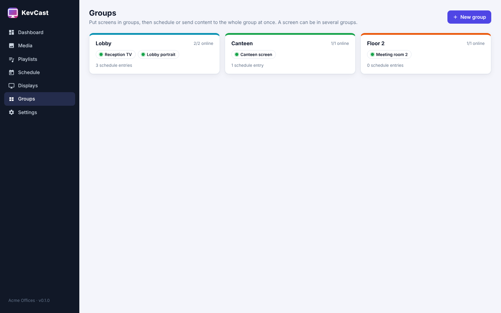

Groups make it easy to manage many screens at once: *Lobby*, *Canteen*, *Floor 2*, *Meeting rooms*…
Anything scheduled for a group plays on **every screen in it**. Adding a screen to a group immediately gives it the group's schedule.
A screen can be in **several groups**: a meeting-room screen can be in both *Floor 2* and *Meeting rooms*.

### Creating a group
Click **New group**. Give it a name, a colour and an optional description, then tick the screens that belong in it.

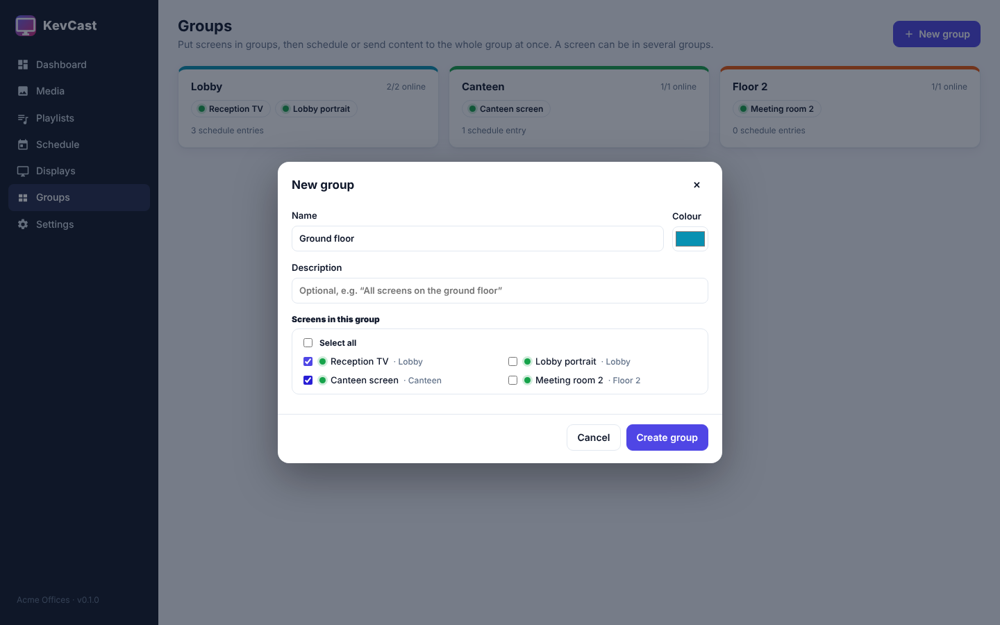

You can also create groups on the fly:
- the **Add to group… → + New group…** action on the Displays page
- the group picker in the *Add display* and *Display settings* dialogs

### A group's page

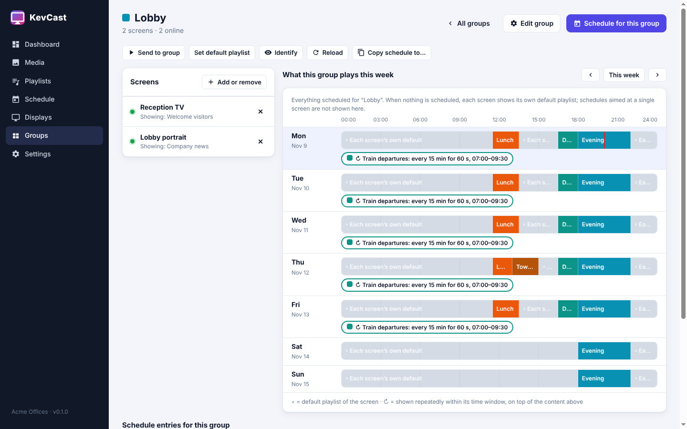

Click a group to open it:

| Part | What you can do |
|---|---|
| **Screens** | See every member online or offline, with what it's showing. **Add or remove** members, or remove one with ✕. |
| **What this group plays this week** | A [week overview](#week-overview) of everything scheduled for the group, including recurring ↻ items |
| **Schedule entries for this group** | The group's own schedule. Click to edit; tick several to change them [all at once](#changing-many-entries-at-once). |
| **Schedule for this group** | Opens the schedule dialog with this group already selected |
| **Send to group** | Make a playlist the default, take over now, or schedule it ([Send to screens](#send-to-screens)) |
| **Set default playlist** | Sets the default playlist of every screen in the group |
| **Identify / Reload** | For all screens in the group |
| **Copy schedule to…** | Copies all of this group's schedule entries to other groups, e.g. to set up *Floor 3* like *Floor 2*. The copies can be changed separately afterwards. |
| **Edit group** | Rename (schedules stay attached), change the colour or description, or **Delete** |

Deleting a group never deletes screens. Schedule entries aimed **only** at that group are removed, so they can't turn into
"all displays" by accident. Entries that also target other screens or groups keep those.

### Updating many screens at once: summary
- **Schedule a group**: one entry plays on all members. Change it once and every member updates.
- **Change many entries at once**: tick entries in any schedule table (see [below](#changing-many-entries-at-once)).
- **Move screens between groups**: tick them on the Displays page → *Add to group…* / *Remove from group…*.
- **Same schedule on another group**: *Copy schedule to…* on the group's page.

## Send to screens

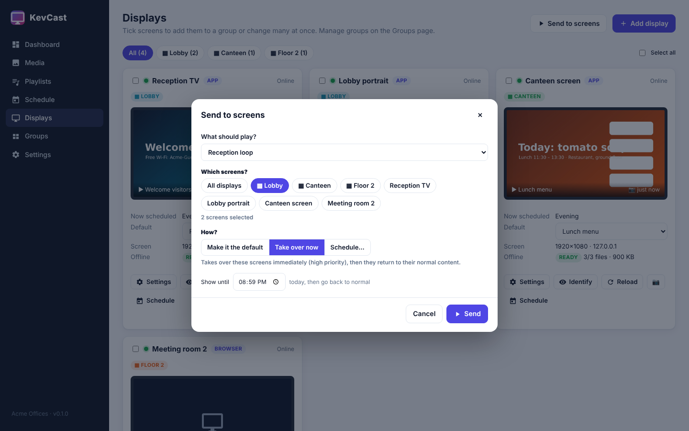

**Send to screens** is the fastest way to put a playlist on many screens. Find it on the Displays page (per group and at the top) and in the playlist editor.

1. Pick the playlist and the screens: all, groups and/or individual screens. The dialog shows how many screens that is.
2. Choose how:
   - **Make it the default**: the playlist becomes the default of those screens. Scheduled content still takes over at its times.
   - **Take over now**: plays immediately with high priority until the time you pick today, then the screens return to normal. Good for announcements and emergencies.
   - **Schedule…**: opens the schedule dialog with the screens already filled in.

## Settings

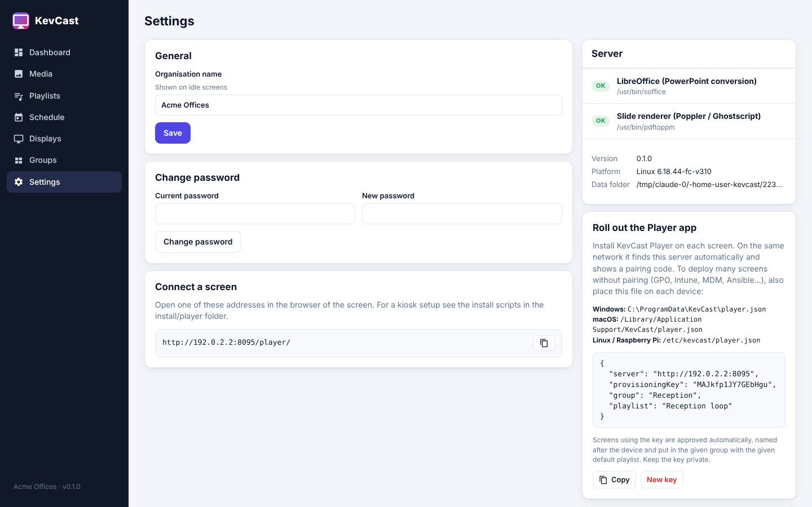

Everyone sees:
- **Your account**: your name and role, **Language**, **Change password** (this signs you out on your other devices) and **Sign out**.
- **Connect a screen**: the player addresses of this server, with copy buttons.
- **Server**: whether LibreOffice and the slide renderer were found (with install hints), version, platform and data folder.

Administrators also see:
- **General**: organisation name, shown on idle screens and in the apps, and the **Clock**: *Automatic* (each screen's
  language), *24-hour* or *12-hour*, the same on every screen: for the idle screen, the clock in the corner and weather
  and traffic slides.
- **Users**: see below.
- **Roll out the Player app**: the provisioning key and a ready-made `player.json` (see [Enterprise roll-out](rollout.md)). **New key** replaces the key; screens that are already connected keep working.
- **Backup**: download the database as JSON (without passwords or media).

### Users

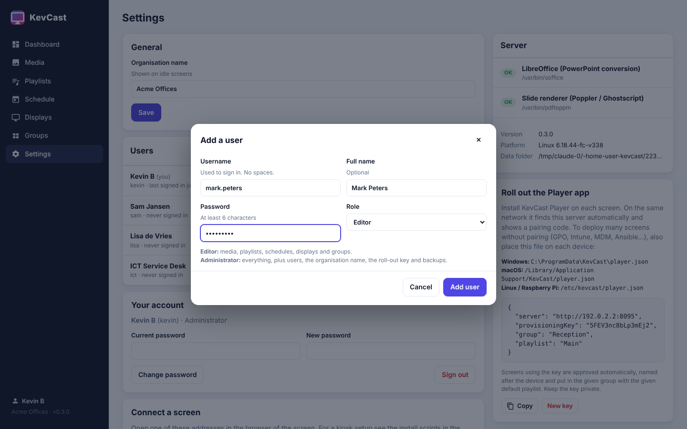

Give everyone who manages the screens their own account: **Settings → Users → Add user**. Choose a username
(used to sign in, no spaces), optionally a full name, a password and a role:

| Role | Can |
|---|---|
| **Editor** | Upload and manage media, playlists, schedules, displays and groups. Send content to screens. |
| **Administrator** | Everything an editor can, plus add, change and remove users, change the organisation name, see and replace the roll-out key, and download backups. |

- Usernames are not case-sensitive.
- **Edit** a user to rename them, change their role or set a new password (for example when they forgot it). A new
  password or role signs that user out everywhere.
- **Remove** a user to stop them signing in. What they made (media, playlists, schedules) stays.
- There is always at least one administrator: the last one can't be removed or made an editor, and you can't remove yourself.
- The same accounts work in KevCast Studio, the Web Studio in a browser and the API.
- **KevCast Studio on Windows** (per user): *Convert PowerPoint files with PowerPoint on this user's computer* makes
  Studio save PowerPoints as PDF with the user's own PowerPoint before uploading, so they look exactly like the original.
  See [KevCast Studio](studio.md#powerpoint-converted-on-your-own-computer-windows).

### Language

KevCast speaks **English, Dutch (Nederlands) and German (Deutsch)**. It follows the language of the computer
(Windows, macOS or Linux, or the browser's language settings) automatically:

- **Web Studio and KevCast Studio**: in the computer's language. Under **Settings → Your account → Language** you can
  pick another one for that computer; *Automatic* goes back to the computer's language.
- **Screens**: the pairing code screen and messages follow the language of the screen's own computer. Dates on the idle
  clock and weather and traffic slides use it too. Set **Language** in the screen's settings to choose another one. Your content itself is never translated.
- **The start page** of the server and the desktop apps' own menus and "connect to server" window follow it as well.
- Any other language falls back to English.

## Tips for good-looking screens

- Make presentations in **16:9**, or 9:16 for portrait screens, so they fill the screen.
- Use big text. People read signage from metres away and only for a few seconds.
- 8–12 seconds per slide is a good default. Use longer for slides with a lot of text.
- Use high-contrast colours. Thin fonts and pastel-on-white disappear on TVs.
- For video, use H.264 MP4 at the screen's resolution (usually 1920×1080).
- Install any special fonts your presentations use on the server, then **Re-convert** them. Otherwise LibreOffice substitutes a similar font.
